# System Architecture & Data Flow Guide

**Project:** UTEHub TechDocs (`doc.utehub.vn`)  
**Architecture Pattern:** Server First, Static Documentation, RLS-Guarded Administrative Layer  
**Version:** 1.0.0 (Phase 2 Foundation)

---

## 1. High-Level Architectural Flows

```mermaid
flowchart TD
    subgraph PUBLIC_FLOW["1. Public Documentation Flow (SSG)"]
        Visitor[Visitor / Developer] -->|HTTPS| CDN[Vercel Edge CDN]
        CDN -->|Static HTML/CSS/JS| FumaDocs[Next.js + Fumadocs SSG]
        FumaDocs -->|Pre-rendered Content| ContentSource[Content Markdown / MDX]
    end

    subgraph PRIVATE_FLOW["2. Private / Administrative Flow"]
        AdminUser[Admin / Evaluator] -->|Credentials| SupaAuth[Supabase Auth]
        SupaAuth -->|HTTP-only Cookie| NextServer[Next.js Server Runtime]
        NextServer -->|Authenticated Client + RLS| SupaDB[(Supabase PostgreSQL)]
    end
```



### Flow 1: Public Documentation Flow (SSG)
* **Path:** `Visitor` → `Vercel CDN` → `Next.js / Fumadocs` → `Static HTML/Assets`.
* **Characteristics:** Pure static pre-rendering (100 static doc routes). Zero database dependencies at request time. Ultra-fast global TTFB and high SEO ranking.
* **Security boundary:** Completely isolated from private administrative data. No cookies, no session lookups, and no dynamic renders.

### Flow 2: Private / Administrative Flow
* **Path:** `Authenticated User` → `Supabase Auth` → `Secure Session Cookies` → `Next.js Server Actions / Server Components` → `Supabase Client` → `PostgreSQL RLS`.
* **Characteristics:** Authentication state verified server-side. All operations run under the user's explicit authenticated identity. Database access is guarded by Row Level Security (RLS) policies.

### Flow 3: Privileged Flow
> [!NOTE]
> **Privileged Supabase client is intentionally absent until a justified server-side use case exists.**  
> Under the principle of *Least Privilege*, all server-side operations in Phase 2 operate via authenticated user identity with RLS. The `SUPABASE_SERVICE_ROLE_KEY` is not configured or exposed.

---

## 2. Directory Structure & Boundaries

```
src/
├── app/
│   ├── (home)/              # Public homepage (SSG with isolated client interactive container)
│   ├── docs/[[...slug]]/    # Public documentation engine (Fumadocs SSG)
│   ├── api/search/          # Static Fumadocs search index
│   ├── admin/               # Administrative route (Target: Server-authenticated in Phase 3)
│   └── layout.tsx           # Global root layout (Must remain static-friendly)
│
├── components/
│   ├── admin/               # Administrative UI components (Client components)
│   ├── docs/                # Interactive document components (Feedback, Code Copy, PDF)
│   └── ui/                  # Reusable presentation components
│
├── lib/
│   ├── supabase/
│   │   ├── client.ts        # Browser client (createBrowserClient, env-only, RLS-guarded)
│   │   ├── server.ts        # Server client ('server-only', cookieStore, RLS-guarded)
│   │   └── middleware.ts    # Session refresh helper for request boundary
│   └── source.ts            # Fumadocs content collections loader
│
├── services/
│   ├── admin.service.ts     # Business logic for units, criteria, and metrics
│   ├── security.service.ts  # Legacy client security helper (slated for Phase 3 migration)
│   └── supabase.service.ts  # Cloud state sync service (slated for Phase 3 normalization)
│
└── types/
    └── database.types.ts    # Generated TypeScript database definitions (Target: Phase 3)
```

---

## 3. Server vs. Client Boundary Rules

| Component Type | Permitted Responsibilities | Prohibited Actions |
|---|---|---|
| **Server Component (Default)** | Fetching static docs, reading session cookies, rendering UI structure, accessing server env | Importing browser hooks, accessing `window`/`localStorage`, attaching event handlers |
| **Client Component (`'use client'`)** | User interactions, form inputs, local UX drafts, browser events | Importing `server-only` modules, holding service role keys, validating security decisions |
| **Server Action** | Authenticating user session, validating input schemas, performing RLS-guarded mutations | Trusting user-submitted `user_id` or `role` directly from arguments |
