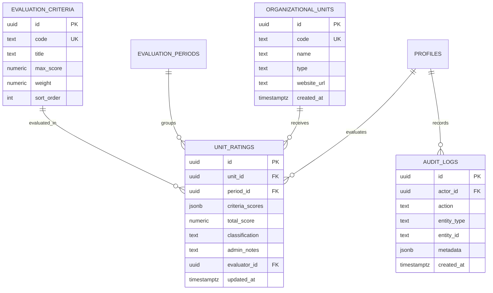

# Phase 3 Database & Application Migration Plan

**Project:** UTEHub TechDocs (`doc.utehub.vn`)  
**Scope:** Controlled transition from legacy single JSON blob (`techdoc_admin_state`) to normalized PostgreSQL schema under Supabase Auth and RLS.  
**Execution Status:** **PLANNING ONLY (NOT EXECUTED IN PHASE 2)**

---

## 1. Target Normalized Schema Design

---

## 2. Authorization & Ownership Matrix

| Entity | Public Read | Authenticated Read | Evaluator Write | Admin Full Access |
|---|---|---|---|---|
| `organizational_units` | Allow (public catalog) | Allow | Deny | Allow (Insert/Update/Delete) |
| `evaluation_criteria` | Allow (standards) | Allow | Deny | Allow (Insert/Update/Delete) |
| `evaluation_periods` | Allow (public status) | Allow | Deny | Allow (Insert/Update/Delete) |
| `unit_ratings` | Allow (aggregate score) | Allow | Update scores/notes | Allow (All) |
| `section_visibility` | Allow (layout toggle) | Allow | Deny | Allow (Update) |
| `audit_logs` | **Deny** | **Deny** | Insert self-events only | Read-only / Immutable |

---

## 3. Step-by-Step 18-Phase Execution Roadmap

1. **Step 1 - Enable Supabase Auth:** Configure email/password authentication on Supabase Cloud.
2. **Step 2 - Provision Initial Admin Profile:** Create admin user credentials in `auth.users` and link to `profiles` table.
3. **Step 3 - Create Normalized Tables:** Run DDL migration script to create tables with strict constraints (PK, FK, CHECK).
4. **Step 4 - Enable RLS on All Tables:** Run `ALTER TABLE ... ENABLE ROW LEVEL SECURITY;`.
5. **Step 5 - Apply Granular RLS Policies:** Write specific `SELECT`, `INSERT`, `UPDATE`, `DELETE` policies matching the matrix above.
6. **Step 6 - Introduce Server-Side Validation:** Implement validation schemas (Zod or standard type guards) in Server Actions.
7. **Step 7 - Migrate Legacy JSON Blob:** Run automated migration script transforming `techdoc_admin_state.state` into normalized rows.
8. **Step 8 - Verify Data Parity:** Check 100% equivalence between migrated records and current legacy JSON state.
9. **Step 9 - Switch Admin Reads:** Update Admin dashboard to read directly from normalized tables.
10. **Step 10 - Switch Admin Writes:** Route all rating updates and notes through authenticated Server Actions.
11. **Step 11 - Decommission Client Pseudo-Auth:** Remove client-side SHA-256 hash checks and `sessionStorage` session token.
12. **Step 12 - Remove localStorage Authority:** Discontinue reading ratings or criteria from `localStorage`.
13. **Step 13 - Remove Configurable Supabase UI:** Remove manual URL/Key inputs from `SettingsSection.tsx`.
14. **Step 14 - Relocate Audit Logs:** Stream all security and rating audit events into PostgreSQL `audit_logs`.
15. **Step 15 - Multi-Persona Security Test:** Verify that unauthenticated requests, evaluators, and admins strictly obey RLS policies.
16. **Step 16 - Production Cutover:** Point all administrative production routes to the authenticated backend.
17. **Step 17 - Rollback Strategy:** Keep `techdoc_admin_state` intact as read-only snapshot for 30 days. If issues arise, flag toggle can revert reads.
18. **Step 18 - Final Deprecation:** Drop legacy `techdoc_admin_state` table only after 30-day stability verification and explicit human approval.
